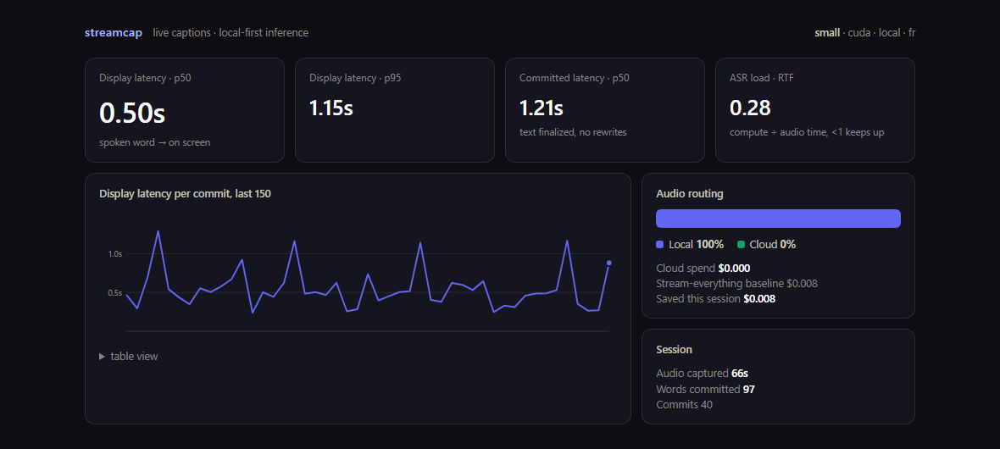
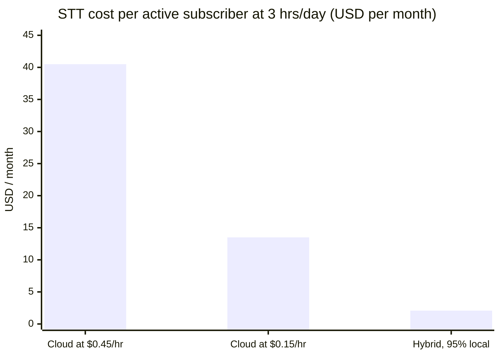
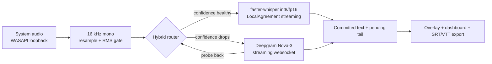

# streamcap

   

Live captions for anything your Windows machine plays. Inference runs on the user's own hardware first, and the pipeline only rents a cloud STT API for the seconds where paying actually buys accuracy. A dashboard tracks every session in real time: latency percentiles, compute load, and the exact dollar amount that was not spent on cloud inference.

I built this to answer one question: does a consumer captioning product really need to stream every minute of audio to a paid API? The answer, measured, is no.



*Real session, mid stream. A French video playing through the speakers, 0.50s median from spoken word to on-screen text, GPU inference, cloud spend $0.000. The `fr` in the corner was detected automatically after the source switched from English.*

## The money problem

Streaming STT is priced per audio hour. Public list prices as of July 2026:

| Provider / tier | $/audio-hr |
|---|---|
| AssemblyAI Universal-Streaming | $0.15 |
| AssemblyAI Universal-3 Pro | $0.45 |
| Deepgram Nova-3 streaming | $0.462 |

A captioning subscriber who uses 3 hours a day burns about 90 audio hours a month. Run that through the price list and the STT bill alone lands between $13.50 and $41 per month, against a subscription that typically sells for about $25. Free-tier users cost the same rates with zero revenue attached. That squeeze is the structural reason cloud-only captioning products cap daily usage and refuse to work offline.

Running inference on the user's machine flips the equation:



The hybrid column assumes a conservative 95% of audio served locally, with the remainder going to Deepgram when local confidence degrades. My own test sessions run at 100% local. On the user's side the footprint is about 1.4 GB of VRAM (or 1 GB of RAM on CPU), a one-time 484 MB model download, and roughly half a cent of electricity per captioned hour.

Three other things fall out of local-first for free: captions keep working with no internet, audio stays on the device unless the cloud leg actually engages, and silence is never billed because the same gate that protects the local model sits in front of the cloud socket.

## Quickstart

```
python -m venv .venv
.venv\Scripts\pip install -r requirements.txt          # add requirements-gpu.txt if you have CUDA
.venv\Scripts\python -m streamcap --overlay --dashboard
```

Play anything. Captions land in an always-on-top overlay and metrics stream to `http://127.0.0.1:8765`.

| Control | Action |
|---|---|
| `F7` | cycle pinned language: auto, en, fr, ar (global hotkey) |
| `F8` | clear captions and reset the stream |
| `F9` | show / hide the overlay |
| `F10` | toggle click-through, so clicks pass through the caption window |
| `Ctrl+F9` | quit: drains the stream, exports the session, exits. Works hidden or click-through |
| `Esc` / `Ctrl+C` | after clicking the overlay: quit / copy the full transcript |

Useful flags: `--model tiny|base|small|medium`, `--language fr` (default is auto-detect with a lock), `--route local|cloud|auto`, `--duration 60`. Every session exports to `sessions/<timestamp>/` as SRT, VTT and plain text.

The cloud leg needs a `DEEPGRAM_API_KEY` (env var or `local/.env`). Without one, streamcap simply runs fully local.

## How it works



Whisper is a batch model. It wants a finished utterance, and if you naively re-transcribe a growing buffer the captions rewrite themselves on every pass. streamcap makes it stream with the LocalAgreement policy from the simultaneous-ASR literature: re-decode the rolling window as audio arrives, and only commit the prefix that two consecutive decodes agree on. Committed text never changes. The still-unstable tail renders dimmed so the user can see it forming.

The router applies cost-aware routing on top. Rolling word probability is the quality signal, failover to the cloud has hysteresis, a failed cloud session backs off for 60 seconds instead of hammering the endpoint, and the session returns to $0 inference as soon as a probe shows local quality has recovered.

Two latencies get reported, on purpose, instead of one flattering number:

- **display latency**: spoken word to visible on screen. p50 0.45 to 0.50s measured live on an RTX 2080 Super
- **commit latency**: spoken word to final, never-rewritten text. p50 around 1.2s

## The parts that were actually hard

**Sentences kept losing their endings.** The last words of an utterance may never be seen by two decodes, because no more audio arrives to agree with. Early versions showed the end of a sentence in the pending tail, then silently dropped it. The fix is endpointing: after 0.7s of silence the freshest hypothesis is by definition final, so it gets flushed through one last decode and committed. Decoding then stops entirely until speech returns, which also means silence is never re-decoded, never hallucinated over, and never billed.

**A paused video poisoned every number after it.** Pause the source for two minutes and the buffer knows nothing about the hole in wall time, so every later commit inherited it as phantom latency. A 120 second pause read as a 120 second p50, forever. Each audio block carries its capture timestamp now; when a block arrives later than the buffer expects, the tail is finalized, the window resets, and the clock resyncs. The promotion delay from a resumed pause is excluded from the percentiles because it measures the pause, not the pipeline.

**Language switches do not fail loudly. They translate.** This one surprised me. Pin Whisper to English, feed it French, and it does not produce garbage. It produces fluent English, covertly translated, with high token confidence. No token-level signal can catch that. The encoder's language posterior can, so it gets audited every 3 seconds of audio; an unambiguous contradiction breaks the lock immediately and re-detection happens in place, keeping the buffered audio so the phrase spanning the switch is committed in the new language rather than eaten. Result: switch a video from English to French mid-session and the captions follow within a couple of seconds, no clicks.

**Decode cost is not a constant.** The same decode on the same machine varies 3 to 4x with GPU thermals and whatever else is running. A fixed decode cadence falls behind real time on a throttled machine, overflows the capture queue, and starts dropping audio. The step now stretches with a moving average of decode cost, so latency degrades gracefully under load instead of the pipeline collapsing. Same session, measured: RTF 0.19 with a cold GPU, 0.45 throttled, captions intact in both cases.

## Benchmark

Reproduce with `python scripts/eval_wer.py --dir <folder of (clip.wav, clip.txt) pairs>`:

| clip | backend | WER | RTF | $/audio-hr |
|---|---|---|---|---|
| test_en | tiny, cpu/int8 | 0.0% | 0.04 | $0.000 |
| test_en | base, cpu/int8 | 0.0% | 0.11 | $0.000 |
| test_en | small, cpu/int8 | **0.0%** | 0.20 | $0.000 |
| test_en | small, cuda/fp16 | **0.0%** | 0.06 | $0.000 |
| test_en | deepgram nova-3 | 0.0% | 0.08 | $0.462 |
| test_fr | tiny, cpu/int8 | 25.5% | 0.04 | $0.000 |
| test_fr | base, cpu/int8 | 10.6% | 0.08 | $0.000 |
| test_fr | small, cpu/int8 | 8.5% | 0.22 | $0.000 |
| test_fr | small, cuda/fp16 | 6.4% | 0.06 | $0.000 |
| test_fr | deepgram nova-3 | **2.1%** | 0.12 | $0.462 |

These are clean synthetic voice clips, which is why English saturates at 0%, so read the shape rather than the absolute numbers: the local `small` model matches the cloud on easy audio at zero cost and holds real time on CPU alone. Where the cloud genuinely wins (French here) the router is exactly the mechanism that buys that quality only for the minutes that need it.

## Testing

The streaming core is covered by 21 deterministic tests: a fake Whisper model with position-accurate word timestamps and a controllable clock, so agreement, endpointing, gap resync, language locking and auditing, trimming, dedup, routing policy, metrics math and export formats are all pinned down without a GPU or network in the loop.

```
.venv\Scripts\pip install pytest
.venv\Scripts\python -m pytest
```

For replaying any clip through the full pipeline at real-time pacing:

```
.venv\Scripts\python scripts\simulate_stream.py local\test_en.wav --speed 1.0
```

## Reading that shaped this

- UFAL `whisper_streaming`: the LocalAgreement-2 commit policy
- Simul-Whisper: attention-guided streaming with truncation detection
- WhisperRT (arXiv:2508.12301): turning Whisper into a causal streaming model. The natural next step past re-decoding
- Hybrid LLM routing: the cost-quality routing shape the hybrid router borrows

## Limitations and next steps

No speaker diarization yet. The benchmark fixtures are small and synthetic; the harness accepts any `(wav, txt)` pairs and a Common Voice slice (en/fr/ar) is the obvious next step. A WhisperRT-style causal encoder would remove the re-decode entirely and push commit latency under a second. Packaging (installer, tray app, auto-start) is deliberately out of scope for a prototype.

## License

Copyright 2026 SpowZy. All rights reserved. See [LICENSE](LICENSE).
