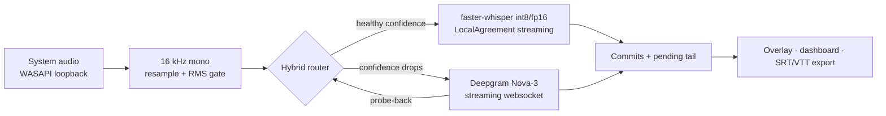

# streamcap

Real-time captions for anything your computer plays — running **local-first**, with a cost-aware cloud fallback and a live metrics dashboard that shows the receipts.

Point it at nothing: it captures system audio straight from the sound card (WASAPI loopback, no virtual cable), transcribes on-device with a streaming Whisper pipeline, and paints captions in an always-on-top overlay in about half a second. When local confidence degrades — heavy accents, crosstalk, noise — it fails over to a cloud STT stream, and fails back as soon as it can. Every second and every cent is measured.

## Why local-first

Cloud streaming STT costs $0.45–0.46 per audio-hour at list price (AssemblyAI Universal-3 Pro, Deepgram Nova-3, July 2026). A captioning subscriber who uses 3 hours a day burns ~90 audio-hours a month — roughly **$41 of inference against a ~$25 subscription**. That unit-economics squeeze is why consumer captioning products cap daily usage and require an internet connection.

Running inference on the user's own machine inverts the model:

- **$0 marginal inference cost** for the majority of sessions — measured live on the dashboard
- **Works offline** — a cloud-only captioning client cannot
- **Audio never leaves the device** unless the cloud leg is actually used — a stronger privacy claim than "we don't persist your audio"
- Cloud spend is reserved for the minutes where it buys accuracy, and silence is never billed

## Quickstart

```
python -m venv .venv
.venv\Scripts\pip install -r requirements.txt          # + requirements-gpu.txt if you have CUDA
.venv\Scripts\python -m streamcap --overlay --dashboard
```

Play anything. Captions appear in the overlay; metrics stream to `http://127.0.0.1:8765`.

| Control | Action |
|---|---|
| `F9` | show / hide the overlay (global hotkey) |
| `F10` | toggle click-through |
| `Ctrl+C` (console mode) | stop and print session stats |

Useful flags: `--model tiny|base|small|medium` · `--language fr` (default auto-detect with lock) · `--route local|cloud|auto` · `--dashboard` · `--duration 60`. Sessions export automatically to `sessions/<timestamp>/` as SRT, VTT and plain text.

The cloud leg needs a `DEEPGRAM_API_KEY` (env var or `local/.env`); without one, streamcap runs fully local.

## How it works



Whisper is an offline model; streamcap makes it stream with the **LocalAgreement** policy: the rolling window is re-decoded as audio arrives, and only the prefix that two consecutive hypotheses agree on is committed. Committed text never rewrites itself; the still-unstable tail renders dimmed. The hybrid router applies cost-aware routing (in the spirit of the Hybrid LLM routing literature) on top: rolling word-probability is the quality signal, failover has hysteresis, and the session returns to $0 inference as soon as a probe shows local quality recovered.

Two latencies are reported honestly instead of one flattering number:

- **display latency** — spoken word → visible on screen (p50 **0.45 s** live on an RTX 2080 Super)
- **commit latency** — spoken word → final, never-rewritten text (p50 **1.2 s**)

## Micro-benchmark

Reproduce with `python scripts/eval_wer.py --dir <folder of (clip.wav, clip.txt) pairs>`:

| clip | backend | WER | RTF | $/audio-hr |
|---|---|---|---|---|
| test_en | tiny · cpu/int8 | 38.8% | 0.04 | $0.000 |
| test_en | base · cpu/int8 | 16.3% | 0.06 | $0.000 |
| test_en | small · cpu/int8 | **4.1%** | 0.18 | $0.000 |
| test_en | small · cuda/fp16 | **4.1%** | 0.12 | $0.000 |
| test_en | deepgram nova-3 | 8.2% | 0.09 | $0.462 |
| test_fr | small · cpu/int8 | 8.5% | 0.21 | $0.000 |
| test_fr | small · cuda/fp16 | 6.4% | 0.05 | $0.000 |
| test_fr | deepgram nova-3 | **2.1%** | 0.11 | $0.462 |

Synthetic-voice clips, so treat the absolute numbers as indicative — the point is the shape: local `small` is competitive with (sometimes better than) the cloud at zero cost and holds real-time on CPU alone, and where the cloud genuinely wins (French here), the router is exactly the mechanism that buys that quality only when needed.

## Design notes

- **Language lock.** Whisper's per-window language detection flaps on short buffers and destabilizes hypotheses; streamcap locks the language once detected confidently and unlocks after a long silence, so a session can follow an English video into a French one.
- **VAD off by default, measured.** `vad_filter` costs ~110 ms per decode call (8 s window, GPU); an RMS gate plus hypothesis agreement already suppress silence hallucinations. The flag exists for noisy environments.
- **Silence is never billed.** The same gate applies to the cloud leg — 21 s of audio in testing produced 19 s of billed stream.
- **Boundary dedup.** Word timings drift between decodes; a committed word reappearing just past the commit boundary is dropped instead of stuttering.

## References

- WhisperRT — turning Whisper into a causal streaming model ([arXiv:2508.12301](https://arxiv.org/abs/2508.12301)) — the natural next step past LocalAgreement re-decoding
- Simul-Whisper — attention-guided streaming with truncation detection
- UFAL `whisper_streaming` — the LocalAgreement-2 policy
- Hybrid LLM: cost-efficient, quality-aware query routing — the router's policy shape

## Limitations & next steps

No speaker diarization yet. The benchmark set is small and synthetic — the harness accepts any `(wav, txt)` pairs, and a Common Voice slice (en/fr/ar) is the obvious next fixture. A WhisperRT-style causal encoder would cut re-decode cost and push commit latency below the second. Packaging (installer, tray app, auto-start) is deliberately out of scope for a prototype.
