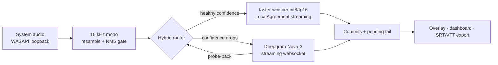

# streamcap

Real-time captions for anything your computer plays — running **local-first**, with a cost-aware cloud fallback and a live metrics dashboard that shows the receipts.

Point it at nothing: it captures system audio straight from the sound card (WASAPI loopback, no virtual cable), transcribes on-device with a streaming Whisper pipeline, and paints captions in an always-on-top overlay in about half a second. When local confidence degrades — heavy accents, crosstalk, noise — it fails over to a cloud STT stream, and fails back as soon as it can. Every second and every cent is measured.

## Why local-first

Cloud streaming STT lists at **$0.15–0.46 per audio-hour** depending on tier (AssemblyAI Universal-Streaming $0.15/hr; AssemblyAI Universal-3 Pro $0.45/hr; Deepgram Nova-3 $0.462/hr — July 2026). A captioning subscriber who uses 3 hours a day burns ~90 audio-hours a month: **$13.50–41 of raw STT inference against a ~$25 subscription**, before LLM summarization, payment fees and backend infra. And a *free-tier* user at 1 hour a day still costs $4.50–14/month — pure burn that scales with signups. That unit-economics squeeze is why consumer captioning products cap daily usage and require an internet connection.

Running inference on the user's own machine inverts the model:

- **$0 marginal inference cost** for the majority of sessions — measured live on the dashboard
- **Works offline** — a cloud-only captioning client cannot
- **Audio never leaves the device** unless the cloud leg is actually used — a stronger privacy claim than "we don't persist your audio"
- Cloud spend is reserved for the minutes where it buys accuracy, and silence is never billed

## Quickstart

```
python -m venv .venv
.venv\Scripts\pip install -r requirements.txt          # + requirements-gpu.txt if you have CUDA
.venv\Scripts\python -m streamcap --overlay --dashboard
```

Play anything. Captions appear in the overlay; metrics stream to `http://127.0.0.1:8765`.

| Control | Action |
|---|---|
| `F7` | cycle pinned language: auto → en → fr → ar (global hotkey) |
| `F8` | clear captions and reset the stream |
| `F9` | show / hide the overlay |
| `F10` | toggle click-through |
| `Ctrl+F9` | quit — drains, exports the session, exits (works even hidden / click-through) |
| `Esc` (after clicking the overlay) | quit |
| `Ctrl+C` (after clicking the overlay) | copy the full session transcript |
| `Ctrl+C` (console mode) | stop and print session stats |

Useful flags: `--model tiny|base|small|medium` · `--language fr` (default auto-detect with lock) · `--route local|cloud|auto` · `--dashboard` · `--duration 60`. Sessions export automatically to `sessions/<timestamp>/` as SRT, VTT and plain text.

The cloud leg needs a `DEEPGRAM_API_KEY` (env var or `local/.env`); without one, streamcap runs fully local.

The streaming core (agreement, endpointing, gap resync, language locking/audit, routing, export) is covered by a deterministic test suite — `pip install pytest`, then `.venv\Scripts\python -m pytest`. Deterministic replay of any clip: `python scripts/simulate_stream.py local/test_en.wav --speed 1.0`.

## How it works



Whisper is an offline model; streamcap makes it stream with the **LocalAgreement** policy: the rolling window is re-decoded as audio arrives, and only the prefix that two consecutive hypotheses agree on is committed. Committed text never rewrites itself; the still-unstable tail renders dimmed. The hybrid router applies cost-aware routing (in the spirit of the Hybrid LLM routing literature) on top: rolling word-probability is the quality signal, failover has hysteresis, and the session returns to $0 inference as soon as a probe shows local quality recovered.

Two latencies are reported honestly instead of one flattering number:

- **display latency** — spoken word → visible on screen (p50 **0.45 s** live on an RTX 2080 Super)
- **commit latency** — spoken word → final, never-rewritten text (p50 **1.2 s**)

## Micro-benchmark

Reproduce with `python scripts/eval_wer.py --dir <folder of (clip.wav, clip.txt) pairs>`:

| clip | backend | WER | RTF | $/audio-hr |
|---|---|---|---|---|
| test_en | tiny · cpu/int8 | 0.0% | 0.04 | $0.000 |
| test_en | base · cpu/int8 | 0.0% | 0.11 | $0.000 |
| test_en | small · cpu/int8 | **0.0%** | 0.20 | $0.000 |
| test_en | small · cuda/fp16 | **0.0%** | 0.06 | $0.000 |
| test_en | deepgram nova-3 | 0.0% | 0.08 | $0.462 |
| test_fr | tiny · cpu/int8 | 25.5% | 0.04 | $0.000 |
| test_fr | base · cpu/int8 | 10.6% | 0.08 | $0.000 |
| test_fr | small · cpu/int8 | 8.5% | 0.22 | $0.000 |
| test_fr | small · cuda/fp16 | 6.4% | 0.06 | $0.000 |
| test_fr | deepgram nova-3 | **2.1%** | 0.12 | $0.462 |

Synthetic-voice clips (clean TTS — that is why English saturates at 0%), so treat the absolute numbers as indicative — the point is the shape: local `small` matches the cloud on easy audio at zero cost and holds real-time on CPU alone, and where the cloud genuinely wins (French here), the router is exactly the mechanism that buys that quality only when needed.

## Design notes

- **Endpoint finalization.** When the input goes quiet, no further audio can refine the pending hypothesis — so it is promoted to final text instead of waiting for (or losing) a second agreement pass. Decoding then stops entirely until speech returns: silence is never re-decoded, never hallucinated over, and never billed.
- **Wall-clock resync.** Paused videos, source switches and buffer overflows leave holes in wall time. The pipeline detects the discontinuity, finalizes the tail, and resyncs its clock — otherwise a 2-minute pause would read as 120 s of phantom latency on every commit after it.
- **Language lock + posterior audit.** Whisper's per-window language detection flaps on short buffers and destabilizes hypotheses; streamcap locks the language once two consecutive ≥ 3 s windows agree. The subtle failure is the reverse: after a mid-stream language switch, Whisper pinned to the old language *covertly translates* the new one with high token confidence — so the encoder's language posterior is audited every ~3 s and breaks a stale lock in seconds, keeping the buffered audio so nothing is lost. A session follows an English video straight into a French one with a one-word transition.
- **Adaptive decode cadence.** Decode cost varies 3–4× with GPU thermals and contention; a fixed cadence would fall behind real time and drop audio. The step stretches with an EMA of decode time, so latency degrades gracefully instead of the pipeline collapsing — same session measured at RTF 0.19 cold and 0.45 throttled, captions intact.
- **VAD off by default, measured.** `vad_filter` costs ~110 ms per decode call (8 s window, GPU); an RMS gate plus hypothesis agreement already suppress silence hallucinations. The flag exists for noisy environments.
- **Silence is never billed.** The same gate applies to the cloud leg — 21 s of audio in testing produced 19 s of billed stream.
- **Boundary dedup.** Word timings drift between decodes; a committed word reappearing just past the commit boundary is dropped instead of stuttering.

## References

- WhisperRT — turning Whisper into a causal streaming model ([arXiv:2508.12301](https://arxiv.org/abs/2508.12301)) — the natural next step past LocalAgreement re-decoding
- Simul-Whisper — attention-guided streaming with truncation detection
- UFAL `whisper_streaming` — the LocalAgreement-2 policy
- Hybrid LLM: cost-efficient, quality-aware query routing — the router's policy shape

## Limitations & next steps

No speaker diarization yet. The benchmark set is small and synthetic — the harness accepts any `(wav, txt)` pairs, and a Common Voice slice (en/fr/ar) is the obvious next fixture. A WhisperRT-style causal encoder would cut re-decode cost and push commit latency below the second. Packaging (installer, tray app, auto-start) is deliberately out of scope for a prototype.
